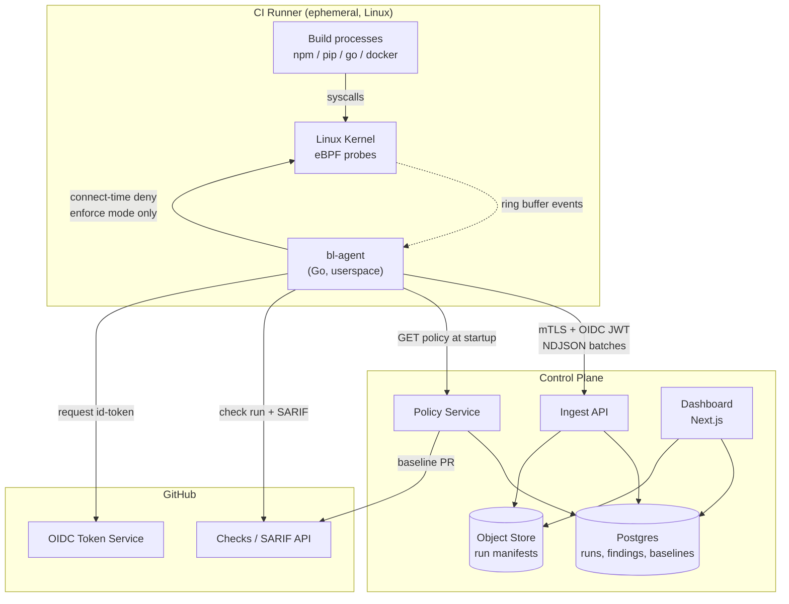
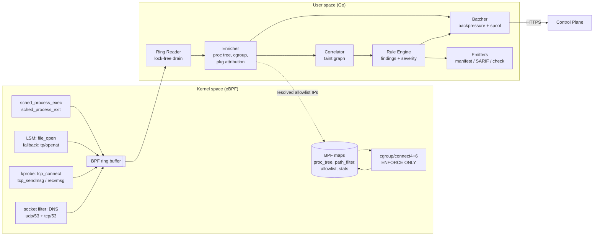
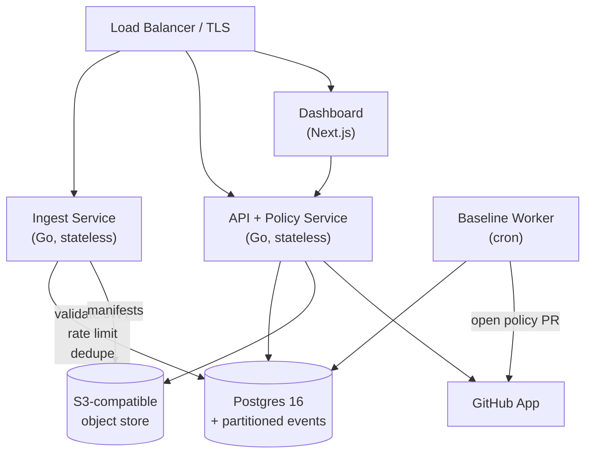
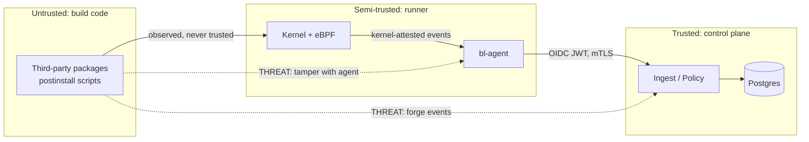

# BuildLens — Architecture

**Status:** Draft v1.0
**Scope:** System design, components, data flow, API contracts, security model.

---

## 1. Design principles

1. **The kernel is the only honest observer.** Anything in userspace can be lied to by the code it watches. All primary signals come from eBPF probes.
2. **Never decrypt. Never touch payloads.** Metadata only: paths, sizes, hashes, destinations, byte counts. This is a permanent constraint — it is what makes the product deployable.
3. **Fail open.** A monitoring agent that breaks builds is uninstalled by Friday. Every failure path exits 0 with a loud, actionable log line.
4. **Findings on the runner, intelligence in the cloud.** Correlation and verdicts are computed locally so PR feedback works even if the control plane is down. Baselines and cross-repo queries need the server.
5. **Never silently lose data.** Dropped events are counted and surfaced. A run with gaps is marked `degraded`, not reported as clean.
6. **Boring first.** Postgres before ClickHouse, a Go binary before a service mesh. Every added moving part must be forced by a measured limit. See §11.

---

## 2. System context



---

## 3. Agent architecture (`bl-agent`)



### 3.1 Probe inventory

| Probe | Attach point | Purpose | Notes |
|---|---|---|---|
| `exec` | `tracepoint/sched/sched_process_exec` | Process tree construction | Captures argv (truncated to 4 KB), exe path, PPID, cgroup id |
| `exit` | `tracepoint/sched/sched_process_exit` | Tree lifetime, exit codes | Prevents PID-reuse aliasing |
| `file_open` | `lsm/file_open`, fallback `tracepoint/syscalls/sys_enter_openat` | Sensitive file reads | Kernel-side prefix filter via `path_filter` map to keep event volume low |
| `connect` | `kprobe/tcp_v4_connect`, `tcp_v6_connect` | Outbound connection attempts | PID, 4-tuple, timestamp |
| `sendmsg`/`recvmsg` | `kprobe/tcp_sendmsg`, `tcp_recvmsg` | Byte accounting | Aggregated in a BPF hash map, flushed periodically — not one event per call |
| `sni` | first `tcp_sendmsg` on a socket | TLS SNI extraction | Parses the **plaintext** ClientHello. No decryption, no key material. |
| `dns` | `socket filter` on udp/53 + `kprobe/tcp_sendmsg` for DoT/tcp | Hostname ↔ IP mapping | Needed for stable allowlists |
| `enforce` | `cgroup/connect4`, `cgroup/connect6` | Deny non-allowlisted egress | Attached to the **job's cgroup only**. Returns 0 → `EPERM` at connect. |

**LSM vs. tracepoint:** `lsm/file_open` (BPF LSM, kernel ≥5.7 with `lsm=bpf`) gives a resolved `struct path` and avoids TOCTOU on the pathname. Where BPF LSM is unavailable, fall back to the `openat`/`openat2` tracepoints and resolve via `d_path`-style dentry walking. The fallback is measurably noisier; the manifest records which path was used so coverage claims stay honest.

### 3.2 Event volume control

A `npm ci` on a large monorepo can generate >2M `openat` calls. Sending all of them is not viable.

- **Kernel-side filtering.** The `path_filter` map holds hashed directory prefixes and basename patterns for sensitive files. Non-matching opens are dropped in the probe, never reaching the ring buffer.
- **Aggregation.** Byte counts accumulate in a per-socket BPF hash map, flushed to userspace every 250 ms rather than per-syscall.
- **Ring buffer sizing.** 8 MB default. Overflow increments a counter that lands in the manifest as `events_dropped`.

> `ponytail:` fixed 8 MB ring buffer and 250 ms flush. Tune from real fleet telemetry once we have it; do not build adaptive sizing before there is data proving fixed values fail.

### 3.3 The correlator (taint graph)

The core of the product. In-memory, single-writer, no locks.

```
Node types:   Process, File, Destination
Edge types:   spawned(P→P), read(P→F), wrote(P→D)

Taint rule:
  A process is TAINTED if it read a sensitive file, OR
  it was spawned by a tainted process after that read.
  (Taint flows down the tree, forward in time only.)

Finding TAINTED_EGRESS is raised when:
  a TAINTED process writes ≥ min_bytes to a destination
  that is not in the allowlist,
  within correlation_window of the read.
```

Defaults: `min_bytes: 512`, `correlation_window: 300s`. Both are policy-tunable.

**Scoring** (0–100), driving severity:

| Signal | Weight |
|---|---|
| Sensitivity tier of file read (credentials > source > config) | 30 |
| Destination unknown to baseline | 25 |
| Destination IP-literal (no DNS lookup preceded it) | 15 |
| Bytes sent, log-scaled | 15 |
| Process is a package lifecycle script, not a first-party step | 10 |
| Read→send elapsed time under 5s | 5 |

≥70 → `critical`, 45–69 → `high`, 25–44 → `medium`, below → informational only.

> `ponytail:` linear weighted score, hand-tuned against the corpus. Deliberately not ML — an unexplainable security verdict is an ignored security verdict. Revisit only if corpus FP rate stalls above target.

### 3.4 Dependency attribution

Resolving "which package did this" from a bare PID:

1. Walk ancestors to the nearest package-manager process.
2. Read lifecycle environment variables (`npm_package_name`, `npm_lifecycle_event`, `PIP_BUILD_...`).
3. Match the process cwd against `node_modules/<pkg>` / pip build temp dirs.
4. Cross-check the resolved name against the lockfile parsed at agent start.

Confidence: **high** = env vars + cwd + lockfile agree; **medium** = two of three; **low** = cwd only; **unknown** = no signal. The confidence level is always shown in the UI. Guessing and being wrong about which package is malicious is worse than saying "unknown".

### 3.5 Failure modes

| Failure | Behavior |
|---|---|
| BPF load fails (no BTF, no CAP_BPF, unsupported kernel) | Log a single actionable warning, exit 0. Build unaffected. |
| Ring buffer overflow | Count drops, mark run `degraded`, continue |
| Control plane unreachable | Spool to local disk, retry with backoff, always emit the local manifest + check run. Run is not lost. |
| Correlator OOM risk (>150 MB) | Evict the oldest exited-process subtrees; record `truncated: true` |
| Agent panic | Recovered at the top level; emit a partial manifest and exit 0 |

---

## 4. Data flow — a single run

```mermaid
sequenceDiagram
    participant W as Workflow
    participant A as bl-agent
    participant K as Kernel/eBPF
    participant P as Policy Service
    participant I as Ingest API
    participant G as GitHub Checks

    W->>A: step 1: uses buildlens/agent@v1
    A->>A: verify binary signature (cosign)
    A->>W: request OIDC id-token
    W-->>A: JWT (aud=buildlens)
    A->>P: GET /v1/policy (JWT)
    P-->>A: policy.yml + baseline digest
    A->>K: load + attach probes, populate maps
    A->>W: daemonize; step exits 0 ("monitoring active")

    loop rest of the job
        W->>K: build syscalls
        K-->>A: events via ring buffer
        A->>A: enrich → correlate → score
        A->>I: POST /v1/runs/{id}/events (batched)
        opt enforce mode, non-allowlisted connect
            K-->>W: EPERM
            A->>A: record BLOCKED finding
        end
    end

    W->>A: post-job hook
    A->>A: finalize manifest, sign
    A->>I: POST /v1/runs/{id}/complete
    A->>G: create check run + upload SARIF
    A->>W: exit 0 (or 1 if fail_on_finding)
```

**Why a post-job hook:** GitHub Actions `post:` steps run even when the job fails or is cancelled. Finalization must happen there, or every failed build loses its forensics — exactly the builds most worth examining.

---

## 5. Control plane



Three stateless Go services plus one cron worker. No queue, no stream processor, no service mesh in v1 — see §11 for the thresholds that would justify each.

### 5.1 Data model (core tables)

```sql
-- Tenancy
orgs(id, gh_org_id, name, plan, created_at)
repos(id, org_id, gh_repo_id, full_name, policy_mode, created_at)

-- Runs
runs(
  id uuid PK, repo_id FK, gh_run_id, gh_job_id, commit_sha, ref,
  started_at, ended_at, status,           -- ok | degraded | failed
  agent_version, kernel_version, runner_os,
  events_dropped int, manifest_url text,
  policy_version, coverage jsonb          -- which probes actually attached
)

-- Time-series-ish, partitioned monthly by created_at
processes(id, run_id FK, pid, ppid, start_ns, exe, argv_redacted,
          pkg_name, pkg_version, attribution_confidence)
file_events(id, run_id FK, process_id FK, path, sensitivity_tier, bytes_read, ts)
net_events(id, run_id FK, process_id FK, dst_ip inet, dst_port,
           hostname, sni, bytes_out, bytes_in, blocked bool, ts)

-- Output
findings(id, run_id FK, type, severity, score, fingerprint,
         process_id FK, evidence jsonb, created_at)

-- Learning
baselines(id, repo_id FK, ref, destinations jsonb, secret_readers jsonb,
          run_count, updated_at)
policies(id, repo_id FK, version, yaml text, source, created_at)
```

**Retention:** 90 days hot in Postgres, manifests in object storage for 1 year (configurable per plan). `findings` are never auto-deleted — they are the audit trail.

**Partitioning:** `processes`, `file_events`, `net_events` are monthly range partitions. Detach and archive rather than `DELETE` at scale.

---

## 6. API contracts

All endpoints are `/v1`, JSON, TLS 1.3. Auth is a GitHub Actions OIDC JWT in `Authorization: Bearer`, validated against GitHub's JWKS with `aud=buildlens` and claim binding to `repository` + `run_id`. **No long-lived API keys for agents.**

### `POST /v1/runs`

Registers a run at agent startup. Idempotent on `(gh_run_id, gh_job_id, attempt)`.

```jsonc
// Request
{
  "gh_run_id": "9876543210",
  "gh_job_id": "job-build-linux",
  "attempt": 1,
  "repo": "acme/payments-api",
  "commit_sha": "a1b2c3...",
  "ref": "refs/pull/482/merge",
  "agent": { "version": "1.4.0", "build_sha": "deadbeef" },
  "runner": {
    "os": "ubuntu-24.04", "kernel": "6.8.0-1014-azure",
    "arch": "x86_64", "btf": true, "lsm_bpf": true, "cpus": 4
  }
}

// 201
{ "run_id": "018f...uuid", "policy_version": 12, "sample_rate": 1.0 }
```

### `GET /v1/policy?repo={full_name}&ref={ref}`

Returns the effective policy. The committed `.buildlens/policy.yml` always wins over server state; the server returns the merged result plus provenance.

```jsonc
{
  "version": 12,
  "mode": "enforce",             // observe | enforce
  "action": "audit",             // audit | block   (enforce only)
  "source": "repo_file",         // repo_file | server_baseline | default
  "egress_allowlist": [
    { "host": "registry.npmjs.org", "reason": "npm registry", "runs_seen": 47 },
    { "host": "*.githubusercontent.com", "reason": "actions cache" },
    { "cidr": "10.0.0.0/8", "reason": "internal artifact mirror" }
  ],
  "sensitive_paths": [
    { "glob": "**/.env*", "tier": "credentials" },
    { "glob": "**/.ssh/**", "tier": "credentials" },
    { "glob": "**/*.pem", "tier": "credentials" }
  ],
  "allowed_secret_readers": [
    { "process": "docker-credential-*", "paths": ["**/.docker/config.json"] }
  ],
  "thresholds": { "min_bytes": 512, "correlation_window_s": 300 },
  "fail_on": ["critical"]        // [] means never fail the build
}
```

### `POST /v1/runs/{run_id}/events`

Batched NDJSON, gzip. Max 4 MB per request. At-least-once; the server dedupes on `(run_id, event_id)`.

```jsonc
// Content-Type: application/x-ndjson; Content-Encoding: gzip
{"t":"proc","id":"e1","ts":1754899200123,"pid":4412,"ppid":4400,"exe":"/usr/bin/node","argv":["node","install.js"],"pkg":"evil-pkg@1.2.3","conf":"high"}
{"t":"file","id":"e2","ts":1754899200456,"pid":4412,"path":"/home/runner/work/app/.env","tier":"credentials","bytes":842}
{"t":"net","id":"e3","ts":1754899200502,"pid":4412,"dst":"185.199.108.153","port":443,"host":"collect.evil.io","sni":"collect.evil.io","out":1204,"in":98}
{"t":"find","id":"e4","ts":1754899200510,"type":"TAINTED_EGRESS","sev":"critical","score":86,"fp":"sha256:...","ev":{"file":"e2","net":"e3","gap_ms":46}}

// 202
{ "accepted": 4, "duplicates": 0, "rejected": [] }
```

### `POST /v1/runs/{run_id}/complete`

```jsonc
// Request
{
  "status": "degraded",
  "ended_at": "2026-08-11T12:04:31Z",
  "events_dropped": 1204,
  "coverage": { "exec": true, "file_open": true, "lsm": false, "dns": true, "enforce": false },
  "stats": { "peak_rss_mb": 78, "cpu_seconds": 3.2, "overhead_pct": 2.1 },
  "manifest_sha256": "..."
}

// 200
{ "manifest_upload_url": "https://...presigned...", "expires_in": 900 }
```

### `GET /v1/search`

Fleet-wide "were we affected" query.

```
GET /v1/search?q=collect.evil.io&type=destination&since=90d
GET /v1/search?q=evil-pkg&type=package
GET /v1/search?q=**/.env&type=file_path
```

```jsonc
{
  "total": 3,
  "results": [
    { "run_id":"018f...", "repo":"acme/payments-api", "commit":"a1b2c3",
      "ts":"2026-08-09T...", "severity":"critical",
      "context":"evil-pkg@1.2.3 postinstall → collect.evil.io (1.2 KB)",
      "manifest_url":"https://..." }
  ]
}
```

### Error convention

RFC 7807 `application/problem+json` throughout.

```jsonc
{ "type":"https://docs.buildlens.io/errors/policy-not-found",
  "title":"No policy for repo", "status":404,
  "detail":"acme/foo has no policy; default observe mode applied",
  "instance":"/v1/policy" }
```

---

## 7. Security model

### 7.1 Trust boundaries



### 7.2 Threat model

| Threat | Mitigation | Residual risk |
|---|---|---|
| Malicious package kills `bl-agent` | Agent death is detected: a run with no `complete` call is flagged `INCOMPLETE_COVERAGE` at severity high. Absence of data is itself a finding. | An attacker who kills the agent still gets a loud alert — acceptable |
| Malicious package forges events to the ingest API | OIDC JWT is bound to `run_id`; agent holds it in memory, never on disk or in env. Events are rate-limited and schema-validated. | Code running as root in the same job could read agent memory. Documented; mitigated by running the agent under a dedicated uid where the runner permits it. |
| Agent binary supply chain compromise | Released with cosign signatures + SLSA L3 provenance; the action verifies the signature before exec. Reproducible builds. | Standard |
| Exfil via an allowlisted destination (GitHub API, npm registry) | Byte-volume anomaly detection against baseline per destination | **Real and acknowledged.** A determined attacker exfiltrating small volumes through an allowlisted host will evade. Stated plainly in docs — see PRD §10. |
| Exfil via DNS tunneling | DNS query volume and entropy heuristics on query names | Medium confidence; part of the corpus |
| BuildLens itself becomes an exfil channel | We transmit **no file contents, no payloads, no env values**. Argv is scrubbed against a secret-pattern denylist. Everything sent is in the manifest the customer can read. | Auditable by design; open-sourcing the agent is the strongest answer (PRD §12) |
| Enforcement blocks a critical build | Fail-open default, `audit` sub-mode before `block`, break-glass via `BUILDLENS_DISABLE=1` | Low |
| Control-plane tenant data leakage | Row-level security in Postgres keyed on `org_id`; every query goes through a tenant-scoped repository layer; integration tests assert cross-tenant reads fail | Standard |

### 7.3 Privilege requirements

The agent needs `CAP_BPF` + `CAP_PERFMON` (kernel ≥5.8) or `CAP_SYS_ADMIN` on older kernels, plus `CAP_NET_ADMIN` for enforce mode. It drops all other capabilities immediately after probe attachment and does not need to remain root. This is documented prominently — asking for kernel access requires earning trust, and the honest answer is the only one that works.

### 7.4 Data classification

| Data | Class | Leaves runner? |
|---|---|---|
| File paths, sizes | Internal | Yes |
| File **contents** | Secret | **Never** |
| Env var names | Internal | Yes |
| Env var **values** | Secret | **Never** |
| Argv | Internal, scrubbed | Yes, after denylist redaction |
| Destination IP/host/SNI | Internal | Yes |
| Network **payload** | Secret | **Never** |
| Source code | Confidential | **Never** |

---

## 8. Enforcement mechanism

Blocking happens at `connect()` via a `cgroup/connect4`+`connect6` BPF program attached to the job's cgroup:

```
1. Resolve allowlist hostnames to IPs at agent start; keep resolving
   as DNS responses are observed (the DNS probe feeds the allowlist map live).
2. On connect(), look up dst IP+port in the allowlist LPM trie map.
3. Hit  → return 1 (allow).
4. Miss → audit mode: emit event, return 1.
          block mode: emit event, return 0 → connect() fails with EPERM.
```

Why this and not iptables/nftables: the cgroup hook has the **PID in context**, so a block carries full attribution. nftables would only tell us an IP was denied. It is also scoped to the job's cgroup, so it cannot affect the runner host or a neighboring job — the difference between a security control and an outage.

**Race:** an IP contacted before its DNS response is observed will miss the map. Mitigated by pre-resolving allowlist entries at startup and a 200 ms grace window on first-contact IPs in audit mode. Documented as a known limit.

---

## 9. Observability of BuildLens itself

- **Agent:** structured JSON logs to stderr, `--debug` dumps raw events. Self-metrics (events/s, drops, RSS, CPU) in every manifest.
- **Control plane:** OpenTelemetry traces, Prometheus metrics, RED dashboards per service.
- **Fleet health:** the dashboard surfaces agent version distribution, degraded-run rate, and probe-attach failure rate by kernel version. Probe failures on a new runner image must be visible within hours, not after a customer reports it.

**Key SLI:** *coverage rate* — the fraction of runs completing with all probes attached and zero drops. This is the honest measure of whether the product works. It goes on the wall.

---

## 10. Scaling path

| Stage | Runs/day | Architecture |
|---|---|---|
| Phase 1–2 | <10k | Single Postgres, 2 API instances, no queue |
| Phase 3 | 10k–100k | Postgres read replica, partitioned event tables, Redis for policy cache |
| Phase 4 | 100k–1M | Events to ClickHouse (Postgres keeps runs/findings/policy), NATS between ingest and storage, regional ingest endpoints |
| Beyond | >1M | Per-region sharding by `org_id`, tiered manifest storage |

Each transition is triggered by a **measured** limit (p99 ingest latency > 300 ms sustained, or Postgres write saturation > 70%), not by a roadmap date.

---

## 11. Deliberately not built

| Not building | Why | Add when |
|---|---|---|
| Kafka / stream processor in v1 | Batched HTTPS to Postgres handles 10k runs/day comfortably. A broker is an on-call burden with no v1 payoff. | Ingest p99 > 300 ms sustained, or ingest and storage need independent scaling |
| Kubernetes for the control plane | Three stateless Go binaries. Fly.io / ECS is a smaller diff and a smaller pager. | Multi-region with complex traffic policy |
| Custom time-series database | Partitioned Postgres to ~100k runs/day. | Query latency on the fleet dashboard exceeds 3s |
| ML anomaly detection | An unexplainable security alert is an ignored security alert. A weighted score is debuggable at 3am. | Corpus FP rate plateaus above 1% with rules exhausted |
| Plugin/rule DSL | One implementation, no second consumer. YAML policy covers every known need. | A design partner needs a rule we cannot express in policy |
| Agent auto-update | The pinned action version *is* the update mechanism, and self-updating code with kernel access is a terrifying supply chain surface. | Never, most likely |

---

## 12. Repository layout

```
buildlens/
├── agent/
│   ├── bpf/              # C eBPF programs, vmlinux.h, bpf2go directives
│   ├── cmd/bl-agent/     # main, CLI, daemonize
│   ├── internal/
│   │   ├── probes/       # load, attach, ring reader
│   │   ├── enrich/       # process tree, cgroup, package attribution
│   │   ├── correlate/    # taint graph
│   │   ├── rules/        # scoring + findings
│   │   ├── policy/       # fetch, parse, merge, allowlist maps
│   │   └── emit/         # manifest, SARIF, check run, ingest client
│   └── testdata/corpus/  # malicious samples + clean builds
├── action/               # GitHub Action wrapper (main + post)
├── control-plane/
│   ├── cmd/{ingest,api,worker}/
│   ├── internal/{store,auth,policy,baseline,github}/
│   └── migrations/
├── web/                  # Next.js dashboard
├── docs/
└── deploy/               # IaC, CI workflows, kernel test matrix
```

---

## 13. Design decision log

| # | Decision | Alternatives rejected | Rationale |
|---|---|---|---|
| D1 | eBPF, not LD_PRELOAD or ptrace | `LD_PRELOAD` (trivially bypassed, misses static binaries); `ptrace` (huge overhead, one tracer per process) | Only the kernel sees everything, and it cannot be lied to by userspace |
| D2 | No TLS interception | MITM proxy | CA injection breaks pinned clients and artifact verification; teams reject it outright. Metadata is sufficient for the taint signal. |
| D3 | Findings computed on-runner | Server-side correlation | Instant PR feedback; works when the control plane is down; less data transmitted |
| D4 | Go for agent userspace | Rust (better ergonomics with aya), C (libbpf native) | `cilium/ebpf` is mature and pure-Go; single static binary; the team ships Go faster. Revisit if GC pauses show up in the overhead budget. |
| D5 | Policy as a committed repo file | Server-side policy only | Reviewable in PRs, versioned with the code, no hidden state, works offline |
| D6 | cgroup/connect for enforcement | nftables, DNS sinkhole | Carries PID context (attribution), cgroup-scoped (blast radius) |
| D7 | Fail open | Fail closed | Adoption. A tool that breaks builds is removed, and removed tools detect nothing. |
| D8 | Postgres for everything in v1 | ClickHouse from day one | One database to operate. Migration path is defined in §10 and triggered by measurement. |
