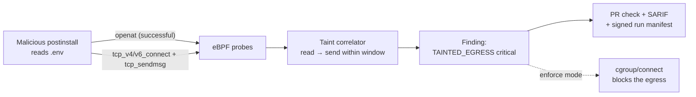

# BuildLens

**A CI/CD supply chain and silent egress sentinel.**

BuildLens runs as the first step of a build job, attaches eBPF probes to the runner kernel, and answers one question for every run:

> Which process, spawned by which dependency, read which sensitive file — and then sent how many bytes to where?

No TLS interception. No proxy. No build modification.

---

## The problem in one paragraph

`npm install` executes arbitrary code from every package in your dependency tree, with full access to your cloud credentials, deploy keys, source code, and unrestricted outbound network. Dependency scanners tell you which packages are *known vulnerable*. Secret scanners tell you which secrets are *committed*. Neither tells you what your build actually **did**. When Codecov's uploader was silently exfiltrating CI environment variables, it ran for two months across thousands of pipelines before anyone noticed — because nobody was watching runtime behavior.

BuildLens watches runtime behavior.

---

## How it works



Kernel probes capture process execs, successful opens of sensitive files (including `.git/config` and other processes' `/proc/<pid>/mem` and `/environ`), outbound TCP connects (IPv4 and IPv6), and bytes sent per process and destination. A DNS listener in the agent maps destination IPs back to the hostnames that were looked up. A userspace correlator builds a taint graph — *this process opened a credential, this same process then sent 1.2 KB to that IP* — and scores the result.

**What the probes do *not* do yet:** hostnames come from plain UDP DNS only, so lookups over DNS-over-HTTPS/TLS/TCP and hardcoded IPs stay as IPs, and a CDN IP shared by many names gets the most recently looked-up one; there is no TLS SNI yet. A successful `open` is evidence of access, not proof the bytes were read; only `openat` is hooked (not `open`/`openat2`), and UDP egress is not observed. "Bytes sent" is what the kernel accepted from that process for that destination over the whole run, not proof those bytes were the file contents. Findings are annotations on the run and the job summary; add the SARIF upload step below to also see them in GitHub code scanning and on PRs.

**AI coding agents in CI.** When Claude Code, Codex, Gemini CLI, the Copilot CLI or Cursor's agent runs in the job, BuildLens labels everything it starts. The job summary gets an activity report even on a clean run: the commands the agent ran (secret-looking strings masked), the secret files it opened and the hosts it contacted. If the agent reads a secret and then anything in its process tree sends data somewhere other than its model API, that's a `TAINTED_EGRESS` finding tagged with the agent: the shape of a prompt-injection exfiltration. Pushing with `git` to `github.com` is allowed, since it shows in the diff; `api.github.com` is not, since a comment or gist can carry the secret out. Dependencies the agent installs are still blamed on the dependency, not the agent.

**We never read file contents or network payloads.** Only paths, sizes, hashes, destinations, and byte counts leave the runner. That constraint is permanent — it is what makes the tool deployable without a MITM CA in every language runtime's trust store.

---

## Installation (early preview)

```yaml
jobs:
  build:
    runs-on: ubuntu-latest
    steps:
      - uses: Seshadri724/BUILD-LENS@v0.2.0   # first step, before your build
      - uses: actions/checkout@v5
      - run: npm ci && npm test
```

**Optional: show findings in code scanning and on PRs.** The SARIF only exists once BuildLens's post step has scored the run, after all your other steps, so a separate `upload-sarif` step would find nothing. Let BuildLens upload it instead:

```yaml
jobs:
  build:
    runs-on: ubuntu-latest
    permissions:
      contents: read
      security-events: write
    steps:
      - uses: Seshadri724/BUILD-LENS@v0.2.0
        with:
          upload-sarif: true
      - uses: actions/checkout@v5
      - run: npm ci && npm test
```

Off by default: nothing leaves the runner unless you turn it on. Code scanning is free on public repos; private repos need GitHub Advanced Security. If the upload fails, BuildLens logs a warning and the build is unaffected.

That is the entire integration. No changes to `package.json`, no changes to build commands, no proxy configuration. The agent starts in the first step; its post step scores the run at the end of the job, even if the job failed. Findings appear as annotations on the run page (errors for critical, warnings for high) and in the job's step summary; the manifest (`buildlens-manifest.json`) and SARIF (`buildlens.sarif`) are written to the workspace.

If the agent cannot load — unsupported runner, missing BTF, no passwordless sudo — it logs a warning and exits 0. **A security tool that breaks builds gets uninstalled by Friday.**

Pin a release tag (`@v0.1.0`) or the moving `@v0` tag, not a branch. Each release tag contains the prebuilt agent; its SHA-256 is on the [release page](https://github.com/Seshadri724/BUILD-LENS/releases).

### Runner requirements

| Requirement | Why | If missing |
|---|---|---|
| Linux x86-64 runner (GitHub-hosted `ubuntu-22.04` is tested end to end; `ubuntu-24.04` passed the Phase 0 load check) | eBPF; only a `linux-amd64` agent is built | warning, exit 0, nothing monitored |
| Kernel with BTF (`/sys/kernel/btf/vmlinux`, kernel 5.8+) | CO-RE probes | warning, exit 0 |
| Passwordless `sudo -n` | loading eBPF needs root | warning, exit 0 |
| `package-lock.json` in the workspace root (or set `lockfile:`) | names the npm package | findings say `unknown` package |

Not supported yet: macOS/Windows or ARM runners, pip/other ecosystems, TLS SNI hostnames, and blocking (see *Honest limitations*).

### Inputs

| Input | Default | |
|---|---|---|
| `lockfile` | `package-lock.json` | lockfile used to attribute processes to npm packages |
| `allow-hosts` | `""` | comma-separated extra hosts install scripts may contact (e.g. binary mirrors) |
| `manifest` | `buildlens-manifest.json` | where to write the run manifest |
| `sarif` | `buildlens.sarif` | where to write SARIF |
| `debug` | `false` | also keep every raw event |
| `upload-sarif` | `false` | upload the SARIF to GitHub code scanning (needs `security-events: write`) |
| `token` | `github.token` | token for the SARIF upload |

To score a recorded event file locally without a kernel, see [quickstart.md](quickstart.md).

---

## Documentation

| Document | What it covers |
|---|---|
| [quickstart.md](quickstart.md) | Score events locally and via the GitHub Action (current ship path) |
| [NEXT_STEPS.md](NEXT_STEPS.md) | What to do this week vs the engineering queue |
| [PRD.md](PRD.md) | Problem, goals, non-goals, personas, competitive positioning, requirements, user stories with acceptance criteria, risks |
| [STRATEGY.md](STRATEGY.md) | Why this is a company rather than a tool: the cross-fleet behavioral corpus, where AI earns its place and where it doesn't, market expansion, business model |
| [ROADMAP.md](ROADMAP.md) | Five phases from feasibility spike to enterprise GA — two parallel tracks, with milestones, deliverables, and hard go/no-go checkpoints |
| [ARCHITECTURE.md](ARCHITECTURE.md) | System design, eBPF probe inventory, taint correlation algorithm, API contracts, threat model, security model |
| [TECH_STACK.md](TECH_STACK.md) | Every technology choice with its justification and what was rejected |

Read them in that order. PRD defines what and why, STRATEGY defines why it compounds, ROADMAP defines when and in what sequence, ARCHITECTURE defines how, TECH_STACK defines with what.

**The short version of STRATEGY:** every run emits `package → process → file → destination`. Across one customer that is a security feature; across ten thousand it is the only behavioral map of the software supply chain in existence — a network effect that per-repo security tools structurally do not have. Detection quality then improves with adoption, which is the difference between a product and a moat.

---

## Current status

**Phase 0 mechanism: pass (CP-0.1, CP-0.2).** eBPF loads on GitHub-hosted `ubuntu-22.04` / `24.04`. Overhead of the *exec-only* attach-once probe was ~0% on a tiny `npm ci` — re-measure once the full probe set exists. **CP-0.3 (vs Harden-Runner) is still a human judgment call.**

**Phase 1 — working agent, narrow probe set.** `bl-agent record` runs as the Action's `main`/`post` and captures exec, successful sensitive-file opens, IPv4/IPv6 TCP connects, and per-destination bytes sent. `bl-agent score` produces a versioned manifest + SARIF (`TAINTED_EGRESS`, `PROCESS_MEMORY_READ`, `INSTALL_SCRIPT_EGRESS`; fail-open, replay-stable) with ancestor-process taint and npm package attribution from the lockfile. CI verifies this end to end against a synthetic exfiltrating `postinstall`, including `bytes_sent > 0`, a `.git/config` token read, another process's `/proc/<pid>/environ`, and a hostname resolved through live DNS. Not built: TLS SNI, pip attribution, enforcement.

---

## What this is not

- Not a dependency scanner — we complement SCA, we do not replace it
- Not a TLS-decrypting proxy — architecturally, permanently
- Not an SBOM generator
- Not a general-purpose runtime security platform for production workloads
- Not a build sandbox — we observe, and optionally block egress; we do not jail syscalls

Full list with the triggers that would change each: [PRD.md §8](PRD.md#8-out-of-scope-for-v1--with-the-trigger-that-would-change-that).

---

## Honest limitations

A security product that overstates coverage is a liability. Known gaps, documented rather than hidden:

- **Exfiltration through an allowlisted destination** (e.g. small volumes via the GitHub API) will evade destination-based detection. Mitigated partially by byte-volume anomaly detection; not solved.
- **Linux only.** eBPF has no Windows or macOS equivalent we can ship at this cost. Windows and macOS runners are unmonitored.
- **Kernel 5.8+ with BTF required.** Older kernels fail open — visibly, with a clear message, but they are unmonitored.
- **Secrets in environment variables.** Reading `process.env` opens no file, so pure in-memory reads can't be tainted. What BuildLens does flag: (a) reads of runner temp env files where step secrets also live on disk (`_temp/_runner_file_commands/add_env_*`, `github_env_*`) taint as `runner_env` — read one, then phone home, and that's a critical `TAINTED_EGRESS`; (b) a dependency's install script calling any host other than the package registry and GitHub (`INSTALL_SCRIPT_EGRESS`). Packages that download binaries from other hosts (e.g. Puppeteer, Cypress) will trip it; add them via the `allow-hosts` input.
- **AI agents are recognized by process name and command line.** Claude Code's path is tested with a simulated agent in CI, not a real session; the Copilot coding agent is matched by its CLI package name and hasn't been seen on a live run. An agent that reads a secret and then opens a PR with `gh` will be flagged.
- **Attribution confidence varies.** When we cannot determine which package spawned a process, we say `unknown` rather than guessing. Naming the wrong package as malicious is worse than naming none.

---

## Validation

Detection claims are meaningless without a fixed test set. `testdata/corpus/` holds 20 malicious samples (recreated from public incidents plus evasion variants) and 50 clean builds across six ecosystems. Every release gates on **≥95% detection, ≤1% false positives**, and the current numbers are published in this README once Phase 1 completes. If we cannot hit them, we publish what we do hit.

---

## Competitive honesty

[StepSecurity Harden-Runner](https://github.com/step-security/harden-runner) is an established product doing eBPF egress monitoring for GitHub Actions, with a generous free tier. It is the direct competitor and it is good.

The difference: Harden-Runner tells you a build contacted an unknown host. BuildLens tells you which npm package read your `.env` thirty milliseconds before it did. File→process→dependency lineage is the wedge — and checkpoint **CP-0.3** requires proving that difference is visible in the first run, before any production code gets written.

---

## License

[Apache-2.0](LICENSE). The in-kernel eBPF programs (`*.bpf.c`) are dual-licensed BSD/GPL, as the kernel requires for GPL-only BPF helpers. Auditability matters for software that requests kernel access.
