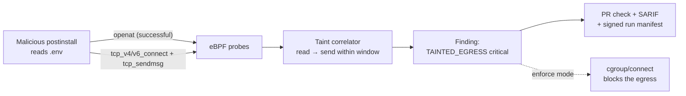

# BuildLens

**A CI/CD supply chain and silent egress sentinel.**

BuildLens runs as the first step of a build job, attaches eBPF probes to the runner kernel, and answers one question for every run:

> Which process, spawned by which dependency, read which sensitive file — and then sent how many bytes to where?

No TLS interception. No proxy. No build modification.

---

## The problem in one paragraph

`npm install` executes arbitrary code from every package in your dependency tree, with full access to your cloud credentials, deploy keys, source code, and unrestricted outbound network. Dependency scanners tell you which packages are *known vulnerable*. Secret scanners tell you which secrets are *committed*. Neither tells you what your build actually **did**. When Codecov's uploader was silently exfiltrating CI environment variables, it ran for two months across thousands of pipelines before anyone noticed — because nobody was watching runtime behavior.

BuildLens watches runtime behavior.

---

## How it works



Kernel probes capture process execs, successful opens of sensitive files, outbound TCP connects (IPv4 and IPv6), and bytes sent per process and destination. A userspace correlator builds a taint graph — *this process opened a credential, this same process then sent 1.2 KB to that IP* — and scores the result.

**What the probes do *not* do yet:** destinations are raw IPs (no DNS or TLS SNI hostname mapping); a successful `open` is evidence of access, not proof the bytes were read; only `openat` is hooked (not `open`/`openat2`), and UDP egress is not observed. "Bytes sent" is what the kernel accepted from that process for that destination over the whole run, not proof those bytes were the file contents. Findings land on the PR as a check run and in GitHub code scanning as SARIF, within sixty seconds of the run ending.

**We never read file contents or network payloads.** Only paths, sizes, hashes, destinations, and byte counts leave the runner. That constraint is permanent — it is what makes the tool deployable without a MITM CA in every language runtime's trust store.

---

## Installation (target UX)

```yaml
jobs:
  build:
    runs-on: ubuntu-latest
    steps:
      - uses: buildlens/agent@v1
        with:
          mode: observe        # observe | enforce
      - uses: actions/checkout@v4
      - run: npm ci && npm test
```

That is the entire integration. No changes to `package.json`, no changes to build commands, no proxy configuration. If the agent cannot load — unsupported kernel, missing capability — it logs a warning and exits 0. **A security tool that breaks builds gets uninstalled by Friday.**

**Today (this repo):** score a JSONL event file with the composite action — see [docs/quickstart.md](docs/quickstart.md). Kernel attach is still the Phase 0 spike.

---

## Documentation

| Document | What it covers |
|---|---|
| [docs/quickstart.md](docs/quickstart.md) | Score events locally and via the GitHub Action (current ship path) |
| [NEXT_STEPS.md](NEXT_STEPS.md) | What to do this week vs the engineering queue |
| [PRD.md](PRD.md) | Problem, goals, non-goals, personas, competitive positioning, requirements, user stories with acceptance criteria, risks |
| [STRATEGY.md](STRATEGY.md) | Why this is a company rather than a tool: the cross-fleet behavioral corpus, where AI earns its place and where it doesn't, market expansion, business model |
| [ROADMAP.md](ROADMAP.md) | Five phases from feasibility spike to enterprise GA — two parallel tracks, with milestones, deliverables, and hard go/no-go checkpoints |
| [ARCHITECTURE.md](ARCHITECTURE.md) | System design, eBPF probe inventory, taint correlation algorithm, API contracts, threat model, security model |
| [TECH_STACK.md](TECH_STACK.md) | Every technology choice with its justification and what was rejected |

Read them in that order. PRD defines what and why, STRATEGY defines why it compounds, ROADMAP defines when and in what sequence, ARCHITECTURE defines how, TECH_STACK defines with what.

**The short version of STRATEGY:** every run emits `package → process → file → destination`. Across one customer that is a security feature; across ten thousand it is the only behavioral map of the software supply chain in existence — a network effect that per-repo security tools structurally do not have. Detection quality then improves with adoption, which is the difference between a product and a moat.

---

## Current status

**Phase 0 mechanism: pass (CP-0.1, CP-0.2).** eBPF loads on GitHub-hosted `ubuntu-22.04` / `24.04`. Overhead of the *exec-only* attach-once probe was ~0% on a tiny `npm ci` — re-measure once the full probe set exists. **CP-0.3 (vs Harden-Runner) is still a human judgment call.**

**Phase 1 — working agent, narrow probe set.** `bl-agent record` runs as the Action's `main`/`post` and captures exec, successful sensitive-file opens, IPv4/IPv6 TCP connects, and per-destination bytes sent. `bl-agent score` produces a versioned manifest + SARIF (`TAINTED_EGRESS`, fail-open, replay-stable) with ancestor-process taint and npm package attribution from the lockfile. CI verifies this end to end against a synthetic exfiltrating `postinstall`, including `bytes_sent > 0`. Not built: DNS/SNI hostnames, pip attribution, enforcement.

---

## What this is not

- Not a dependency scanner — we complement SCA, we do not replace it
- Not a TLS-decrypting proxy — architecturally, permanently
- Not an SBOM generator
- Not a general-purpose runtime security platform for production workloads
- Not a build sandbox — we observe, and optionally block egress; we do not jail syscalls

Full list with the triggers that would change each: [PRD.md §8](PRD.md#8-out-of-scope-for-v1--with-the-trigger-that-would-change-that).

---

## Honest limitations

A security product that overstates coverage is a liability. Known gaps, documented rather than hidden:

- **Exfiltration through an allowlisted destination** (e.g. small volumes via the GitHub API) will evade destination-based detection. Mitigated partially by byte-volume anomaly detection; not solved.
- **Linux only.** eBPF has no Windows or macOS equivalent we can ship at this cost. Windows and macOS runners are unmonitored.
- **Kernel 5.8+ with BTF required.** Older kernels fail open — visibly, with a clear message, but they are unmonitored.
- **Attribution confidence varies.** When we cannot determine which package spawned a process, we say `unknown` rather than guessing. Naming the wrong package as malicious is worse than naming none.

---

## Validation

Detection claims are meaningless without a fixed test set. `testdata/corpus/` holds 20 malicious samples (recreated from public incidents plus evasion variants) and 50 clean builds across six ecosystems. Every release gates on **≥95% detection, ≤1% false positives**, and the current numbers are published in this README once Phase 1 completes. If we cannot hit them, we publish what we do hit.

---

## Competitive honesty

[StepSecurity Harden-Runner](https://github.com/step-security/harden-runner) is an established product doing eBPF egress monitoring for GitHub Actions, with a generous free tier. It is the direct competitor and it is good.

The difference: Harden-Runner tells you a build contacted an unknown host. BuildLens tells you which npm package read your `.env` thirty milliseconds before it did. File→process→dependency lineage is the wedge — and checkpoint **CP-0.3** requires proving that difference is visible in the first run, before any production code gets written.

---

## License

TBD. Open-sourcing the agent is under active consideration ([PRD §12](PRD.md#12-open-questions)) — auditability matters enormously for software that requests kernel access, and it would make the control plane the product.
