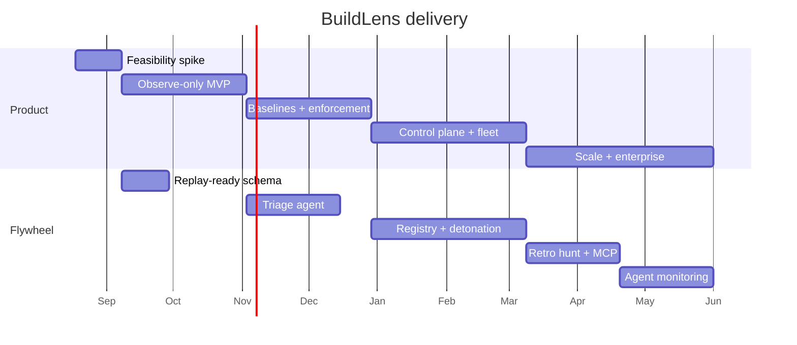
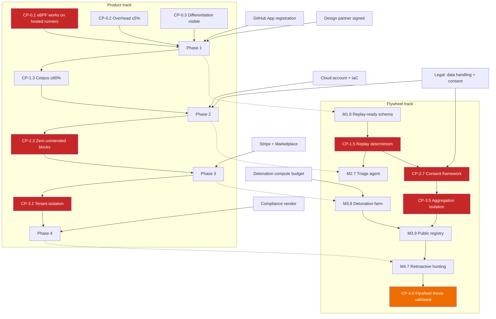

# BuildLens — Roadmap

**Status:** Draft v1.0
**Horizon:** ~11 months to GA
**Team assumption:** 2 engineers (1 systems/kernel, 1 backend/full-stack) through Phase 2; +1 in Phase 3; +1 in Phase 4.

---

## How to read this

Each phase has **milestones** (what gets built), **deliverables** (what exists at the end), **checkpoints** (measurable go/no-go gates), and **dependencies** (what must be true first).

**Checkpoints are gates, not status meetings.** A failed checkpoint means stop and re-plan, not "carry it into next sprint." Each has a stated fallback.

Durations are for the stated team size. Phase 0 is the only one whose outcome can end the project.

### Two tracks

There is a **product track** (the agent, enforcement, the platform — what customers install) and a **flywheel track** (the cross-fleet behavioral corpus — what makes detection improve with adoption, and what makes this a company rather than a tool). The rationale for the second track is in [STRATEGY.md](STRATEGY.md); this document schedules it.

The flywheel track is deliberately small in Phases 0–2 — three schema requirements in Phase 1 that cost almost nothing now and become a rewrite if skipped — and only becomes substantial in Phase 3, once there is enough traffic for aggregate data to be credible.

**The product track always has priority.** If a phase is behind, flywheel work slips first. A great corpus attached to a tool nobody installs is worth nothing.

---

# Phase 0 — Feasibility spike (3 weeks)

**Goal:** kill the project cheaply if eBPF is not viable on hosted runners. Nothing else matters until this is answered.

**Deliberately throwaway.** Optimize for answers, not code quality. No tests beyond what proves the answer, no abstractions, no CI. This code gets deleted.

### Milestones

| # | Milestone | Detail |
|---|---|---|
| M0.1 | Load a trivial BPF program on `ubuntu-latest` | Attach `sched_process_exec`, print PIDs. Confirm CAP_BPF availability, BTF presence, and whether `sudo` is sufficient. |
| M0.2 | Kernel matrix survey | Test `ubuntu-22.04`, `ubuntu-24.04`, GitHub-hosted + self-hosted + ARC + a `docker:dind` container. Record kernel version, BTF, BPF LSM availability, `unprivileged_bpf_disabled`. |
| M0.3 | End-to-end signal on one real repo | exec + openat + tcp_connect probes, dump to a file. Run against a real Node repo doing `npm ci`. |
| M0.4 | Overhead measurement | 30 A/B runs of the same build with and without probes. Median and p95 wall clock. |
| M0.5 | Detection proof | One synthetic malicious package that reads `.env` and POSTs it. Verify the read→send correlation is visible in raw events. |
| M0.6 | Competitive teardown | Install Harden-Runner on the same repo. Screenshot both outputs side by side. Document exactly what we show that they don't. |

### Deliverables

- `spike/` directory with throwaway probe code
- **Feasibility memo** (2 pages): kernel matrix table, overhead numbers, sample event output, go/no-go recommendation
- Side-by-side competitive comparison with screenshots

### Checkpoints

| ID | Gate | Pass criteria | If failed |
|---|---|---|---|
| **CP-0.1** | eBPF loads on GitHub-hosted runners | Probes attach and emit events on `ubuntu-22.04` and `ubuntu-24.04` | **Project-altering.** Pivot to self-hosted + container runners only. Re-run market sizing before proceeding — this roughly halves the TAM. |
| **CP-0.2** | Overhead acceptable | Median added wall clock ≤5% on a representative `npm ci` build | Reduce probe surface (drop byte accounting, sample opens), re-measure. If still >10%, the product is unsellable to platform teams — stop. |
| **CP-0.3** | Differentiation is real and visible | The side-by-side shows at least one finding class we surface that Harden-Runner does not, visible in the first run without configuration | Rethink positioning before writing production code. Do not proceed on the assumption that "better attribution" sells itself. |

**Dependencies:** GitHub org with Actions minutes; a self-hosted runner VM; access to 3–5 representative real repos (design partner or OSS).

**Exit criteria:** all three checkpoints pass, or a documented pivot is agreed.

---

# Phase 1 — Observe-only MVP (8 weeks)

**Goal:** a real agent that a design partner installs on a real repo and gets useful output from. Observe only — no blocking, no policy.

### Milestones

| # | Milestone | Weeks | Detail |
|---|---|---|---|
| M1.1 | Agent skeleton + probe loader | 1–2 | Go + `cilium/ebpf`, CO-RE via `bpf2go`, ring buffer reader, graceful fail-open on load error. Kernel test matrix in CI (5 kernels via VM images). |
| M1.2 | Core probes | 2–4 | exec, exit, file_open (LSM + tracepoint fallback), tcp_connect, sendmsg/recvmsg aggregation. Kernel-side path prefix filter. |
| M1.3 | DNS + SNI | 4–5 | Socket filter for DNS, ClientHello SNI parse. IP↔hostname map maintained in userspace. |
| M1.4 | Process tree + package attribution | 5–6 | PID+start_ns keying, ancestor walk, npm/pip lifecycle env detection, lockfile cross-check, confidence levels. |
| M1.5 | Correlator + first rule | 6–7 | Taint graph, `TAINTED_EGRESS` and `NEW_PROCESS_EGRESS` rules, weighted scoring. |
| M1.6 | GitHub Action + output | 7–8 | `action.yml` with `main:` and `post:`, run manifest JSON, SARIF upload, check run summary. Cosign-signed release binaries. |
| M1.7 | Validation corpus v1 | throughout | 10 malicious samples, 20 clean builds, automated scoring harness in CI. |

#### Flywheel track — M1.8, schema foundations (≈3 days of work, unrecoverable if skipped)

Cheap now, a rewrite later. Rationale: [STRATEGY.md §6](STRATEGY.md#6-the-one-change-this-forces-on-the-engineering-plan).

| Requirement | Implementation | Why it cannot wait |
|---|---|---|
| **Deterministic, versioned rule evaluation** | Rules carry a `ruleset_version`; scoring uses event timestamps only, never wall clock; sorted iteration everywhere; a golden-file test asserts byte-identical findings when a stored event stream is replayed | Retroactive hunting requires replaying old runs through new rules and getting reproducible results. Any nondeterminism destroys it permanently. |
| **Stable package identity** | Every process and finding carries `(ecosystem, name, version, integrity_hash)` — never a resolved path or lockfile position | Cross-customer aggregation joins on this key. Manifests written without it are unjoinable forever. |
| **Anonymization boundary in the schema** | Aggregatable fields (package identity, destination hostname, file *tier*) live in a separate struct from repo-identifying fields (absolute paths, repo name, commit SHA) at write time | A boundary enforced by types cannot be forgotten. A boundary enforced by a query filter will be, exactly once, catastrophically. |

### Deliverables

- `buildlens/agent@v0` — installable GitHub Action, signed releases
- Run manifest schema (versioned JSON Schema), replay-safe and aggregation-ready
- SARIF output visible in GitHub code scanning
- Corpus harness reporting detection rate and FP rate on every PR
- `docs/quickstart.md`

### Checkpoints

| ID | Gate | Pass criteria | If failed |
|---|---|---|---|
| **CP-1.1** (wk 4) | Probes stable across the kernel matrix | All 5 target kernels attach cleanly; unsupported kernels fail open with a clear message; zero build breakage in 200 test runs | Narrow supported kernel range and document it explicitly. Do not ship "probably works." |
| **CP-1.2** (wk 6) | Attribution quality | ≥85% of egress connections attributed to a named package or first-party step at medium+ confidence, measured on 20 real repos | Ship with lower confidence bands surfaced honestly in the UI rather than guessing. Attribution accuracy is the wedge — if it stays below 70%, revisit CP-0.3. |
| **CP-1.3** (wk 8) | Corpus performance | ≥90% detection on malicious samples, ≤2% FP on clean builds | Tune scoring weights. Do not ship to a design partner above 5% FP — one noisy week destroys trust permanently. |
| **CP-1.4** (wk 8) | Design partner install | 1 partner installs unaided from the quickstart in <10 min and reports ≥1 genuinely surprising finding | Sit with them, watch where they stall, fix the onboarding. Repeat before Phase 2. |
| **CP-1.5** (wk 8) | Replay determinism | Replaying 100 stored event streams through the same ruleset version produces byte-identical findings, 100/100 | **Fix before Phase 2.** Every flywheel play depends on this and none of them can be built on a nondeterministic engine. |

**Dependencies:** Phase 0 exit. GitHub App registration (checks + code scanning write). Kernel VM images for the CI matrix. 1 signed design partner.

**Risks:** BPF LSM unavailable on hosted runners → tracepoint fallback is noisier and costs a week of tuning. Budget for it.

---

# Phase 2 — Baselines and enforcement (8 weeks)

**Goal:** move from "here is what happened" to "here is what should happen, and we stopped what shouldn't."

### Milestones

| # | Milestone | Weeks | Detail |
|---|---|---|---|
| M2.1 | Minimal control plane | 1–3 | Ingest + policy services (Go), Postgres schema + migrations, OIDC JWT validation against GitHub JWKS, run/event/finding persistence, presigned manifest upload. |
| M2.2 | Agent → control plane | 3–4 | Batched NDJSON client, gzip, backpressure, local disk spooling on failure, retry with jitter. Manifest always emitted locally regardless of connectivity. |
| M2.3 | Baseline learning | 4–5 | After N default-branch runs, compute destinations / secret readers / expected process set. Confidence scoring on each entry. |
| M2.4 | Policy file + PR bot | 5–6 | `.buildlens/policy.yml` schema, merge semantics (repo file wins), GitHub App opens a policy PR with commented, justified entries. |
| M2.5 | Enforcement | 6–8 | `cgroup/connect4`+`connect6` program, LPM trie allowlist map, live DNS-driven map updates, `audit` and `block` sub-modes, cgroup scoping, break-glass. |
| M2.6 | Corpus v2 | throughout | 20 malicious samples incl. evasion variants (DNS tunneling, slow drip, allowlisted-host exfil); 50 clean builds across 6 ecosystems. |

#### Flywheel track — triage agent (weeks 5–8)

Detection is not the bottleneck for AppSec teams; triage is. A finding currently costs an engineer ~40 minutes to answer *"is this real, and what do I do?"* This is the highest per-customer-value item on the flywheel track and the cheapest to build.

| # | Milestone | Detail |
|---|---|---|
| M2.7 | Finding → incident narrative | Given a `TAINTED_EGRESS` finding, fetch the implicated package source from the registry, diff against the prior version, locate the code responsible for the observed kernel behavior, and produce a narrative with the full evidence chain. Rendered in the PR check and the manifest. |
| M2.8 | Data consent framework | Opt-in flag per org, package-level aggregates only, structurally incapable of emitting repo-identifying fields (enforced by the M1.8 schema boundary). Contract language drafted with counsel. |

**M2.8 is a hard prerequisite for all Phase 3 flywheel work.** It is scheduled here because the Phase 2 legal review is already happening — see Dependencies below.

### Deliverables

- Control plane deployed (staging + prod), IaC in `deploy/`
- `buildlens/agent@v1` with `mode: enforce`
- Policy schema docs + migration guide from observe to enforce
- Published corpus results in the repo README
- Triage narratives on critical findings
- Signed data-processing terms covering aggregate corpus contribution

### Checkpoints

| ID | Gate | Pass criteria | If failed |
|---|---|---|---|
| **CP-2.1** (wk 4) | Ingest reliability | Zero data loss across 1,000 runs including forced network failures; degraded runs correctly labeled | Fix before baselines — baselines built on lossy data are worse than no baselines. |
| **CP-2.2** (wk 6) | Baseline quality | Generated policy for 10 real repos requires ≤3 manual edits each; zero legitimate destinations missing after 5 baseline runs | Increase baseline run count, or ship policy generation as "suggested, review carefully" and be explicit about it. |
| **CP-2.3** (wk 8) | Enforcement safety | 500 enforce-mode runs across 10 repos: zero unintended blocks of legitimate traffic; blocks correctly attributed; break-glass verified working | **Hard gate.** Do not ship `block` mode. Ship `audit` only until clean. One customer outage caused by us is unrecoverable. |
| **CP-2.4** (wk 8) | Corpus v2 | ≥95% detection, ≤1% FP | Ship anyway with published numbers if ≥90/≤2 — honest numbers beat delayed ones — but this becomes the top Phase 3 priority. |
| **CP-2.5** (wk 8) | Design partner in enforce | ≥1 partner runs `block` mode on a production repo for 2 weeks with zero incidents | Extend the audit-mode period. Enforcement is unsellable without this proof point. |
| **CP-2.6** (wk 8) | Triage narrative quality | On 20 corpus findings, the narrative correctly identifies the responsible source lines in ≥80% and is never confidently wrong about which package is at fault | Ship narratives as "suggested context," clearly labeled, with the raw evidence chain always shown alongside. Never let a generated explanation stand alone as the verdict. |
| **CP-2.7** (wk 8) | Consent framework signed off | Counsel approves opt-in terms; an integration test proves repo-identifying fields cannot reach the aggregate path | **Hard gate for Phase 3 flywheel work.** Registry and cross-fleet features do not start until this passes. |

**Dependencies:** CP-1.3 passed. CP-1.5 passed (replay determinism — the triage agent and all later flywheel work assume it). Cloud account + IaC. GitHub App permissions extended (contents write for policy PRs). Legal review of data handling **and aggregate corpus consent** before storing customer run data — brief counsel on both in the same engagement.

---

# Phase 3 — Control plane and fleet visibility (10 weeks)

**Goal:** answer "were we affected?" across the whole fleet in three seconds. This is what converts a per-repo tool into a platform purchase.

### Milestones

| # | Milestone | Weeks | Detail |
|---|---|---|---|
| M3.1 | Dashboard foundation | 1–3 | Next.js app, GitHub OAuth, org/repo/run views, run manifest viewer with the process tree rendered as an interactive graph. |
| M3.2 | Fleet search | 3–5 | Search by package / destination / IP / file path across 90 days. Postgres GIN indexes + partition pruning; <3s p95. |
| M3.3 | Findings workflow | 5–6 | Triage states (open / acknowledged / false positive / resolved), stable fingerprints for cross-run dedupe, suppression rules with expiry. |
| M3.4 | Alerting | 6–7 | Slack + email + generic webhook. Weekly fleet digest. Per-team routing. |
| M3.5 | Multi-tenancy hardening | 7–8 | Postgres row-level security on `org_id`, tenant-scoped repository layer, cross-tenant isolation integration tests, org roles (admin / member / read-only). |
| M3.6 | Onboarding + billing | 8–10 | GitHub Marketplace listing, self-serve org onboarding, Stripe metering, free tier limits. |

#### Flywheel track — the corpus becomes a product (weeks 3–10)

This is where the flywheel stops being schema hygiene and starts being the moat. Rationale: [STRATEGY.md §2](STRATEGY.md#2-moat-plays).

| # | Milestone | Weeks | Detail |
|---|---|---|---|
| M3.7 | Aggregation pipeline | 3–5 | Nightly rollup of consented runs into package-behavior aggregates keyed on `(ecosystem, name, version, integrity_hash)`. Observation counts, distinct-org counts, destination sets, file-tier access patterns. Org-identifying data never enters this path. |
| M3.8 | Detonation farm | 4–8 | Subscribe to the npm + PyPI publish firehose. Install each new version in a throwaway Firecracker microVM under the agent. Randomized environment fingerprints and varied dwell time to resist sandbox detection. Top 50k packages by download count first; long tail lags. |
| M3.9 | Package Behavior Registry | 7–10 | Public `buildlens.io/pkg/<name>` — no login, free. Observed behavior, version-over-version behavioral diff, observation counts. Rate-limited. |
| M3.10 | OSS research report | 10 | Detonate the top 10k npm + PyPI packages, publish the findings. Seeds the registry and buys the initial attention. |

> **Resourcing reality:** M3.7–M3.10 is roughly one engineer for the full phase. It fits only if the Phase 3 hire lands on time. If it slips, cut in this order: M3.10 → M3.9 → M3.8, and keep M3.7 — the aggregation pipeline is what the rest depends on, and delaying it wastes consented data that is already flowing.

### Deliverables

- `app.buildlens.io` dashboard
- Fleet search + weekly digest
- GitHub Marketplace listing, self-serve signup
- Billing with usage metering
- Public status page
- Package Behavior Registry, public and free
- Detonation farm covering the top 50k packages
- Published OSS supply chain research report

### Checkpoints

| ID | Gate | Pass criteria | If failed |
|---|---|---|---|
| **CP-3.1** (wk 5) | Search performance | p95 <3s over 100k runs / 90 days with realistic data volume | Add materialized rollups. If Postgres cannot hold it, trigger the ClickHouse migration (ARCHITECTURE §10) early. |
| **CP-3.2** (wk 8) | Tenant isolation | Third-party pentest or structured internal review finds zero cross-tenant data access paths | **Hard gate.** No multi-tenant GA without this. |
| **CP-3.3** (wk 9) | Self-serve onboarding | 5 external users complete signup → first monitored run unaided, median <15 min | Instrument the funnel, find the drop-off, fix, retest. |
| **CP-3.4** (wk 10) | Alert quality | Design partners report the weekly digest as useful, not noise; <1 unsubscribe per 10 orgs | Reduce digest scope to critical findings and new destinations only. |
| **CP-3.5** (wk 6) | Aggregation isolation | Red-team the aggregation pipeline: no org-identifying field is reachable in any registry output. Verified by an external reviewer, not just tests. | **Hard gate.** Nothing public ships until it passes. This is the risk that turns the moat into a scandal ([STRATEGY.md §9](STRATEGY.md#9-risks-specific-to-this-strategy)). |
| **CP-3.6** (wk 8) | Detonation farm yield | ≥5 genuinely malicious packages independently detected before any public disclosure, over 4 weeks of operation | If yield is near zero, either the ecosystem is cleaner than assumed or the sandbox is being evaded. Diagnose which before publishing anything — a research report built on a farm that malware detects and sleeps through is worse than no report. |
| **CP-3.7** (wk 10) | Registry credibility | ≥1M package-versions with observed behavior; spot-check 50 entries against manual analysis with zero material errors | Delay the public launch. A registry that is wrong once about a popular package loses the credibility it exists to build. |

**Dependencies:** CP-2.3 passed. CP-2.7 passed (consent framework — blocks all flywheel work in this phase). Stripe account. Marketplace approval (lead time is 2–4 weeks — start at week 6). Design/frontend capacity (+1 engineer). Detonation compute budget (~$1–3k/mo spot).

---

# Phase 4 — Scale and enterprise (12 weeks)

**Goal:** be buyable by a company with a procurement department.

### Milestones

| # | Milestone | Weeks | Detail |
|---|---|---|---|
| M4.1 | GitLab CI support | 1–4 | Agent already platform-agnostic; build the GitLab wrapper, JWT auth via GitLab OIDC, MR comments, GitLab-native policy file location. |
| M4.2 | Self-hosted + ARC first-class | 3–5 | DaemonSet deployment for ARC (one agent per node, cgroup-scoped per job), documented Docker-in-Docker support, air-gapped agent distribution. |
| M4.3 | Enterprise auth | 5–7 | SAML SSO, SCIM provisioning, audit log export, configurable retention. |
| M4.4 | Scale-out | 6–9 | ClickHouse for event tables, NATS between ingest and storage, regional ingest endpoints, EU data residency. **Only the parts the measured load actually requires.** |
| M4.5 | SOC 2 Type II | 1–12 | Controls implementation, evidence collection, vendor review, audit window opens week 8. |
| M4.6 | Detection depth | 8–12 | DNS tunneling heuristics, byte-volume anomalies on allowlisted destinations, build-artifact tamper detection (filesystem writes to output paths). Fleet-informed confidence: a destination unseen across the entire corpus scores far higher than one merely unseen in this repo. |

#### Flywheel track — compounding returns (weeks 1–12)

| # | Milestone | Weeks | Detail |
|---|---|---|---|
| M4.7 | Retroactive hunting | 1–4 | Replay stored event streams against new rulesets (enabled by CP-1.5). New IOC → auto-scan 12 months of history → auto-open incidents with the affected repos, credentials, and time windows. |
| M4.8 | MCP server | 4–6 | Registry over MCP so coding agents can query package behavior *before* adding a dependency. Shifts interception from execution to selection. |
| M4.9 | Behavioral attestations | 6–9 | Signed in-toto predicate: this artifact was built by a process tree that contacted only these hosts and read zero credentials. The compliance SKU — EU CRA / SSDF / FedRAMP evidence. |
| M4.10 | Agent monitoring beta | 8–12 | Same eBPF core pointed at AI coding agents on developer machines and in agent sandboxes. Separate GTM motion. **Gated on a design partner actively pulling for it** — no speculative market entry. |
| M4.11 | Blast radius | 9–12 | Cloud IAM integration: exposed credential → what it grants → what to rotate → which audit window to review. |

> **Do not attempt all five.** This is a menu ordered by leverage, not a commitment. M4.7 is nearly free given CP-1.5 and should ship regardless. The rest wait for a specific customer pulling for them. Five GTM motions across one phase is how a four-person team dies ([STRATEGY.md §9](STRATEGY.md#9-risks-specific-to-this-strategy)).

### Deliverables

- GitLab CI integration GA
- ARC / self-hosted deployment guides + Helm chart
- SSO / SCIM / audit export
- EU region
- SOC 2 Type II report (or audit in progress with a Type I issued)
- Advanced detection rules shipped and corpus-validated
- Retroactive hunting live across retained history
- Whichever of M4.8–M4.11 a design partner pulled for

### Checkpoints

| ID | Gate | Pass criteria | If failed |
|---|---|---|---|
| **CP-4.1** (wk 4) | GitLab parity | Feature parity with GitHub except native code scanning; 1 design partner running it | Ship as beta, clearly labeled. Do not claim parity we don't have. |
| **CP-4.2** (wk 9) | Scale validated | 100k runs/day sustained in load test; ingest p99 <300ms; zero data loss | Do not onboard large accounts until it holds. Overselling capacity is how trust dies. |
| **CP-4.3** (wk 12) | Enterprise readiness | Security questionnaire answerable without gaps; SOC 2 Type I issued; 1 enterprise contract signed | Contract may slip; the questionnaire must not. |
| **CP-4.4** (wk 12) | Detection depth | Evasion variants in corpus v3 detected ≥80%; documented honestly where we cannot detect | Publish the limits. Overstating coverage on a security product is a lie that eventually surfaces. |
| **CP-4.5** (wk 4) | Retroactive hunt correctness | Replay a known historical incident across 12 months of retained runs; correctly identify every affected run with zero false incidents | Fix before enabling auto-incidents. A false "you were breached" email is unrecoverable. |
| **CP-4.6** (wk 12) | **Flywheel thesis validated** | Detection quality is measurably better *because of* corpus size — demonstrated by scoring the corpus with fleet signals enabled vs. disabled, with a material gap | **The most important checkpoint in this document.** If there is no gap, the thesis in [STRATEGY.md §1](STRATEGY.md#1-the-thesis) is wrong: this is a good tool, not a company. Stop investing in the flywheel, redirect entirely to product depth and enterprise GTM, and reset fundraising expectations accordingly. Worth knowing explicitly rather than assuming. |

**Dependencies:** CP-3.2 passed. CP-3.5 passed. Compliance vendor selected by Phase 3 end. +1 engineer. Enterprise design partner identified during Phase 3. A named design partner pulling for whichever of M4.8–M4.11 gets built.

---

## Cross-phase engineering standards

These start in Phase 1 and never lapse.

| Standard | Requirement |
|---|---|
| Kernel test matrix | Every agent PR runs the probe suite across ≥5 kernel versions in VMs |
| Corpus gate | Every agent PR reports detection and FP rate; regressions block merge |
| Overhead gate | Every agent PR runs the benchmark; >5% median overhead blocks merge |
| Fail-open test | A chaos test that corrupts BPF objects, revokes capabilities, and kills the agent mid-run — the build must still succeed |
| Migration safety | Every schema migration is backward compatible for one release; agents N-2 must keep working |
| Signed releases | cosign signature + SLSA provenance on every agent binary. Non-negotiable for a tool with kernel access. |

---

## Dependency graph

Red nodes are hard gates: failure stops the phase or the track. The orange node is not a gate but a **thesis test** — failing it does not stop work, it redirects the company (see CP-4.6).

Note the two dependencies that cross tracks and are easy to miss: **CP-1.5 blocks the entire flywheel** (nondeterministic scoring makes replay impossible), and **CP-2.7 blocks everything public** (no aggregation without consent). Both are cheap in their own phase and expensive in any later one.

---

## What we are explicitly not doing, and when that changes

| Deferred | Trigger to reconsider |
|---|---|
| Windows / macOS runners | 3 paying accounts blocked on it |
| Jenkins / CircleCI / Buildkite | GitHub + GitLab stable, ≥2 accounts requesting |
| Filesystem write monitoring | Egress detection at ≥95% with ≤1% FP for a full quarter |
| Container image scanning | Never — solved market, not our wedge |
| **Static** malware signature feed | Never. The detonation farm (M3.8) produces *behavioral* intelligence, which is a different and stronger asset. We do not pattern-match source. |
| Payload inspection | Never |
| Mobile / desktop app | Never |
| LLM as the detection engine | Never — it destroys replay determinism (CP-1.5) and produces unexplainable verdicts. AI belongs in triage and explanation, not the verdict path ([STRATEGY.md §3.2](STRATEGY.md#32-do-not-build-these)). |
| Agent monitoring (M4.10) before a design partner asks | It is a distinct GTM motion, possibly a distinct company. Entering it speculatively splits a four-person team across two markets. |

---

## Resourcing

| Phase | Eng | Split | Other |
|---|---|---|---|
| 0 | 1 systems engineer | all product | — |
| 1 | 1 systems + 1 backend | product; M1.8 is ~3 days | Design partner recruiting (founder) |
| 2 | 1 systems + 1 backend | ~80% product / 20% triage agent | Legal review (data handling **and** consent); cloud ~$500/mo |
| 3 | +1 full-stack (3 total) | 2 product / 1 flywheel | Design contractor; Marketplace + Stripe; cloud ~$2k/mo; detonation compute ~$1–3k/mo |
| 4 | +1 (4 total) | 2 product / 2 flywheel | Compliance vendor ~$25–40k; cloud ~$8k/mo; enterprise sales support |

**Phase 3 is the crunch.** The flywheel work there (M3.7–M3.10) is a full engineer-phase and it only fits if the hire lands on time. If it slips, cut per the note in Phase 3 — do not slow the product track to protect the flywheel.

---

## Leading indicators to watch

Track from Phase 1. If these turn the wrong way, the checkpoint gates are catching problems too late.

| Indicator | Healthy | Alarm |
|---|---|---|
| Coverage rate (runs with all probes, zero drops) | >98% | <95% |
| Median build overhead | <3% | >5% |
| Findings acknowledged vs. ignored | >60% acknowledged | <30% — we are noise |
| Repos moving observe → enforce | >40% within 60 days | <15% — enforcement isn't trusted |
| Support tickets per 500 runs | <1 | >3 |
| Uninstalls within 30 days | <10% | >25% |

**Flywheel track** (from Phase 3):

| Indicator | Healthy | Alarm |
|---|---|---|
| Orgs opted into aggregate contribution | >70% | <40% — the moat cannot form; revisit the consent framing |
| Registry package-versions with observed behavior | growing >20%/mo | flat — coverage is stalling, check the detonation farm |
| Malicious packages found pre-disclosure | >5/month | 0 for two months — the farm is being evaded, or is broken |
| Findings where fleet signal changed the severity | >15% | <5% — the corpus is not yet earning its cost |
| Triage narratives accepted without correction | >70% | <40% — narratives are noise, pull them back to "suggested context" |
